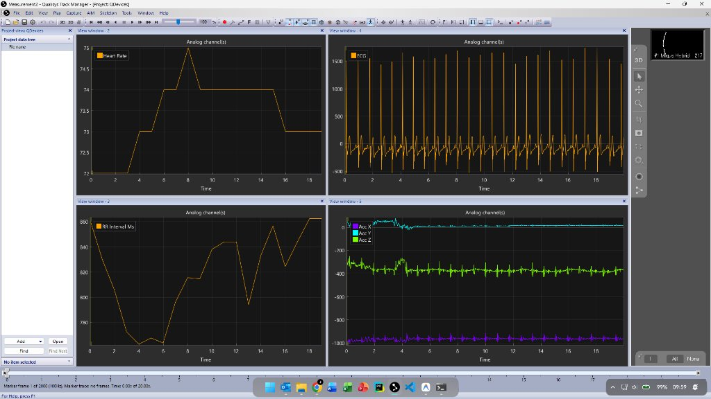

# QDevice Polar H10

> **Qualisys Track Manager integration plugin for Polar H10 sensors (HR, RR, Battery, 130 Hz ECG & 200 Hz 3-axis Accelerometer).**  
> *Developed at **Technosport / ISM** (UMR 7287 CNRS — Aix-Marseille Université) • [**Releases**](../../releases)*

---

## 🚀 Getting Started

1. Close **Qualisys Track Manager (QTM)**.
2. Download and run the latest installer from **[Releases](../../releases)**.
3. **Pair your Polar H10 in Windows** (*Settings > Bluetooth & devices > Add device > Bluetooth*) if you plan to stream **ECG** or **Accelerometer** (required by Polar PMD on Windows 11).
4. Open **QTM > Project Options > Input Devices > Add Device...** and enable **Polar H10 Heart Rate Monitor**.
5. Put on the humidified Polar H10 strap, go to **Generics > Polar H10 Heart Rate Monitor**, enable **ECG** / **Accelerometer** as needed, click **Locate Devices**, and click **OK**.

---

## 🛠️ Channels & Options

By default, **Heart Rate, RR Interval, Sensor Contact, and Battery (`1 Hz`)** are enabled for fast, reliable recording. **ECG (`130 Hz`)** and **3-axis Accelerometer (`25–200 Hz`)** are **disabled by default** and can be enabled on demand in QTM *(both share the same `Buffer Latency Ms` pre-buffer so they remain time-aligned with each other; for precision mocap alignment, resync the fixed BLE offset against a marker or reference accelerometer)*.

Each sensor group streams at its **native hardware rate** (no destructive resampling):

| Channel / Option | Native Rate / Values | Description |
| :--- | :--- | :--- |
| **`Heart Rate`** | `1 Hz` (`bpm`) | Instantaneous heart rate (BLE GATT `0x180D` / `0x2A37`) |
| **`RR Interval Ms`** | `1 Hz` (`ms`) | Latest R-R interval (`1/1024 s` resolution) |
| **`Sensor Contact`** | `1 Hz` (`0 / 1`) | Skin electrode contact status |
| **`Battery Pct`** | `1 Hz` (`0–100%`) | Battery level (BLE GATT `0x180F` / `0x2A19`) |
| **`ECG`** *(optional)* | `130 Hz` (`µV`) | Raw 14-bit ECG stream via Polar PMD `0x00` (`Enable ECG`) |
| **`Acc X / Y / Z`** *(optional)* | `25 / 50 / 100 / 200 Hz` (`mG`) | 3-axis MEMS accelerometer via Polar PMD `0x02` (`Enable Accelerometer`, `±2 / ±4 / ±8 G`) |
| **`Buffer Latency Ms`** | `300–1500 ms` (default `850`) | Shared jitter pre-buffer keeping ECG and ACC time-aligned |
| **`Device Filter`** | String | Optional filter by Polar ID or MAC address |
